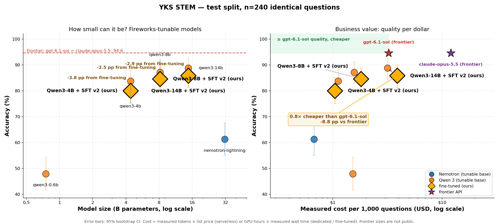
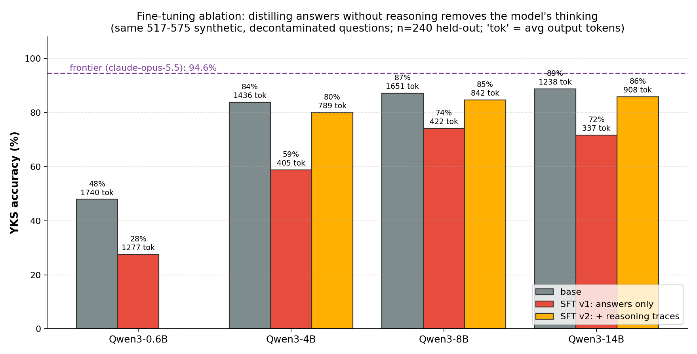

# Tiny Tutors: training small language models to be good tutors

**Can a small open model tutor students as well as a frontier model, at a fraction of the cost?**

Exam preparation is mostly about mistakes. A student learns the most when someone explains *why* the wrong
option looked right, gives a hint instead of the answer, and then offers a new problem aimed at that exact
misconception. Frontier models can do this, but tutoring every wrong answer for every student is too
expensive and too slow at scale, and student data has to leave the institution.

This project measures how far **small, trainable open models** can go as tutors, and what training them on
distilled reasoning actually buys. It covers two answer-key tasks:

- **YKS STEM:** 240 held-out Turkish university-entrance-exam questions (math, physics, chemistry; 5 options)
- **Math olympiad:** 276 final-answer competition problems (AIME, HMMT, BRUMO, SMT, CMIMC 2025–2026)



## Why this can work

1. **Answer keys make tutoring verifiable.** Every question has a ground-truth answer, so each step can be
   checked automatically: solutions, generated practice questions and training targets. That makes it
   possible to train small models on *verified* data and measure them honestly.
2. **The skill is narrow.** A tutor for one exam needs a bounded curriculum, not general knowledge. Narrow
   skills are where small models get closest to frontier models.
3. **Most tutoring work is cheap; the hard cases are rare.** A small model can handle the solution and the
   common cases, and only uncertain cases need a larger model. Small-model self-agreement turns out to be a
   usable signal for that routing (below).
4. **Humans are already in the loop.** Teachers reviewing diagnoses produce exactly the preference data
   (approved vs corrected) that DPO-style training needs, so the tutor can keep improving on real mistakes.

## Method

- **Same harness for every model:** same prompt, same answer parser and same held-out questions. Metrics:
  - accuracy with a 95% bootstrap CI, and an exact McNemar test on paired answers vs the reference
  - YKS net score (+1 correct, −¼ wrong, 0 blank)
  - p50/p95 latency and cost per exam
- **Reference models:** Claude Opus 5.5 and GPT-6.1 Sol, also run at high reasoning effort.
- **Small-model ladder:** Qwen3 0.6B, 4B, 8B and 14B, Nemotron Lightning 30B-A3B and `gpt-oss-120b`,
  served on Fireworks (serverless and dedicated GPUs).
- **Training data (synthetic, verified, decontaminated):**
  - 575 YKS-style questions written by one model and solved independently by another; a question is kept
    only if both agree
  - anything overlapping the evaluation set is removed
  - training targets carry the teacher's verified reasoning trace
- **Training:** managed LoRA SFT (rank 8) on Fireworks, 8 jobs across the ladder. Each fine-tuned model is
  compared against its own base on the same questions.
- **Test-time compute:** reasoning effort, 8-vote self-consistency, a small→large cascade, and exam mode with
  blanks allowed.
- **Tutoring quality:** 60 simulated wrong answers. Each tutor writes a misconception diagnosis, a 3-step hint
  ladder and a solution, judged 1–5 by a model from a different vendor.

## Results

### Solving: YKS (240 held-out questions)
| system | runs on | accuracy (95% CI) | Δ vs Claude (McNemar p) | net / 40 q | $ / 40-q exam | p50 latency |
|---|---|---|---|---|---|---|
| Claude Opus 5.5 (reference) | API | 94.6% (91.7–97.1) | – | 37.3 | $0.479 | 5.7 s |
| GPT-6.1 Sol | API | 94.6% (91.7–97.1) | +0.0 pp (p=1.0) | 37.3 | $0.130 | 3.9 s |
| **Cascade: Nemotron → gpt-oss-120b** | open models | **91.7% (87.9–95.0)** | −2.9 pp (p=0.09, n.s.) | 35.8 | $0.109 | (rate-limited) |
| **gpt-oss-120b** | open model | **88.3% (84.2–92.1)** | −6.2 pp (p=0.003) | 34.2 | **$0.019 (25× cheaper)** | **3.0 s** |
| Qwen3-14B | open, tunable | 88.8% (84.6–92.5) | −5.8 pp (p=0.001) | 34.4 | $0.127 | 11.5 s |
| Qwen3-8B | open, tunable | 87.1% (82.9–91.2) | −7.5 pp | 33.5 | $0.063 | 13.9 s |
| Qwen3-4B | open, tunable | 83.8% (78.8–88.3) | −10.8 pp | 31.9 | $0.045 | 4.4 s |
| Qwen3-0.6B | open, tunable | 47.9% (41.7–54.2) | −46.7 pp | 14.0 | $0.061 | 7.2 s |
| Nemotron Lightning 30B-A3B | open, tunable | 61.3% (55.0–67.5) | −33.3 pp | 20.6 | $0.027 | 7.3 s (p95 203 s) |

- **A single open model** (`gpt-oss-120b`) is **25× cheaper and about 2× faster** than Claude Opus 5.5, at
  −6.2 pp accuracy.
- **A two-model open cascade** reaches **91.7%**, statistically indistinguishable from Claude on these
  questions (p=0.09), at **4.4× lower cost**. Nemotron answers three times, and the 58% of questions where its
  answers disagree escalate to `gpt-oss-120b`. Its latency here was inflated by API rate limits and isn't
  representative.
- **Size:** a 14B model ties a 117B model; a 4B dense model beats a 30B MoE by 22 pp; below 4B, accuracy
  collapses.

Full tables, per-subject breakdowns and vote-agreement calibration: [`results/yks/test/report.md`](results/yks/test/report.md).

### Training: what distillation does and doesn't buy


| model | base | SFT on final answers only | SFT with reasoning traces |
|---|---|---|---|
| Qwen3-0.6B | 47.9% | 27.5% (−20.4) | – |
| Qwen3-4B | 83.8% | 58.8% (−25.0) | 80.0% (−3.8) |
| Qwen3-8B | 87.1% | 74.2% (−12.9) | 84.6% (−2.5) |
| Qwen3-14B | 88.8% | 71.7% (−17.1) | 85.8% (−3.0) |
| Nemotron Lightning | 61.3% | 7.9% (degenerate output) | – |

- **Training on answers without reasoning teaches a model to stop thinking.** Output fell from ~1,400–1,700
  tokens to ~340–420, and accuracy fell 13–25 points. This held at every size.
- **Keeping the verified reasoning trace in the target recovers most of the loss,** consistently across 4B,
  8B and 14B. With ~530 synthetic examples, though, it doesn't push the models *above* their base. At this
  data scale, the base model and how it's served matter more than SFT.

### Tutoring: diagnosing a student's mistake
| tutor | solution correctness | misconception quality | hint ladder | p50 latency | $ / diagnosis |
|---|---|---|---|---|---|
| gpt-oss-120b | 4.65 | 2.97 | 3.17 | 3.9 s | **$0.00062** |
| Claude Opus 5.5 | 4.95 | 4.38 | 4.30 | 9.2 s | $0.02352 |

The small model's solutions are nearly as correct, at **38× lower cost**. The gap is in the *teaching*:
naming the misconception and building hints that guide without giving the answer away. That gap is the main
target for training ([`results/tutor/report-yks.md`](results/tutor/report-yks.md)).

### Harder task: math olympiad (276 problems)
| system | accuracy (95% CI) | $ / problem | avg output tokens |
|---|---|---|---|
| Claude Opus 5.5 | 99.3% (98.2–100) | $0.036 | 1,771 |
| GPT-6.1 Sol | 97.8% (96.0–99.3) | $0.012 | 1,076 |
| gpt-oss-120b | 72.5% (67.0–77.5) | $0.004 | 6,478 |

The same method transfers, but on hard problems the gap widens to −27 pp. Small models aren't a substitute
there yet. ([`results/olympiad/test/report.md`](results/olympiad/test/report.md))

### Other findings
- **More test-time compute didn't help on YKS:** high reasoning effort scored 87.9% and 8-vote majority 88.3%,
  versus 88.3% for a single medium-effort call.
- **Self-agreement is calibrated:** when Nemotron's three answers agree, it's right 92.9–95% of the time, which
  is the basis for cheap routing.
- **Runaway generations are a real small-model failure mode:** Nemotron hit the 8K-token cap on 56/240
  questions (p95 latency 203 s). Report p95, not just p50.
- **Abstention:** under exam scoring, letting Claude leave questions blank didn't raise its net score
  (37.0 vs 37.3). It's already well calibrated.

## What we learned

1. **Distill reasoning, not answers.** Answer-only targets silently remove a model's chain of thought.
2. **Choose and serve the right base before fine-tuning.** Model choice and cheap serving gave the largest gains.
3. **Route by confidence.** Cheap small-model votes plus selective escalation get close to frontier accuracy.
4. **The tutoring gap is pedagogical, not mathematical.** Small models solve well; they explain mistakes less well.

## Next steps

- **Reinforcement fine-tuning with the exam reward** (+1 / −¼ / 0) on thousands of verified examples, so the
  model learns when to abstain.
- **Train on the teaching objective directly:** DPO on teacher-corrected diagnoses (the tutor app exports
  approved and corrected pairs), aimed at misconception and hint quality.
- **Route:** the small model writes solutions, and a frontier model handles only uncertain or hard cases.
- **On-prem serving** of 4B–8B tutors, so student data stays inside the institution.
- **Fresh, contamination-free test sets,** figure-based questions with a vision model, and more answer-key exams.

## Limitations

- **The test set is small** (240 YKS questions), so check the confidence intervals.
- **Contamination:** frontier models score 97–100% even on 2025–26 contests, so it can't be ruled out.
- **Figures:** 8 YKS test questions reference figures that the models can't see. They're kept and scored.
- **Tutoring scores** come from an LLM judge, which is an approximation; hand-check a sample.
- **Cost is estimated** as measured tokens × list price, or GPU-hours × measured wall time for dedicated
  deployments. That cost depends on throughput.
- **The Nemotron fine-tune** produced degenerate output. Its cause (training vs low-precision serving) wasn't
  isolated, so it's reported as a failure.

## Reproduce

```bash
python3 -m venv .venv && source .venv/bin/activate
pip install -r requirements.txt
cp .env.example .env                 # FIREWORKS_API_KEY (+ FIREWORKS_ACCOUNT_ID); reference models use AWS credentials
python -m yks.data                   # YKS: data/tune.jsonl (60) + data/test.jsonl (240)
python -m yks.olympiad               # olympiad: downloaded at runtime (CC BY-NC-SA)

python -m yks.run_eval --split test --systems claude-opus-5.5 gpt-6.1-sol oss120 cascade-nemo-120
python -m yks.ladder --split test --systems qwen3-0.6b qwen3-4b qwen3-8b qwen3-14b   # dedicated, auto-deleted
python -m yks.report --split test --baseline claude-opus-5.5
python -m yks.tutor_eval --tutors gpt-oss-120b claude-opus-5.5 --judge gpt-6.1-sol --n 60
```

Training recipe: [`docs/FINETUNE.md`](docs/FINETUNE.md). All systems (models, prices, strategies) are
defined in [`configs/systems.yaml`](configs/systems.yaml).

**Tutor app (local):** a student / teacher / class interface on top of the tutor engine. It covers mistake
diagnosis, a hint ladder, verified practice for the weakest topic, and teacher review exported as SFT/DPO data.

```bash
python -m yks.tutor build-pool --model gpt-oss-120b
streamlit run app.py --server.address localhost
```

## Repository

```
configs/systems.yaml       models, prices and systems under test
yks/data.py, olympiad.py   benchmark builders (YKS split; temporal olympiad split)
yks/prompts.py, grading.py shared prompts; answer extraction and symbolic grading
yks/client.py              model client (OpenAI-compatible + Bedrock Converse), token or GPU-hour cost
yks/strategies.py          single / self-consistency / cascade
yks/run_eval.py, report.py runner and statistics (CIs, McNemar, calibration)
yks/ladder.py              deploy → evaluate → delete each dedicated base model
yks/make_sft*.py           synthetic, verified, decontaminated training data (answers / reasoning traces)
yks/submit_sft.py, deploy_sft.py   train, then deploy → evaluate → delete fine-tuned models
yks/plot_finetune.py       size/cost value chart and fine-tuning ablation chart
yks/tutor.py, tutor_eval.py, store.py, topics.py   tutor engine, tutoring benchmark, human-feedback store
app.py                     local tutor app
data/                      evaluation splits and synthetic training data
results/                   every model output and report used above
```

## Data and credits

- [TurkishMMLU](https://huggingface.co/datasets/AYueksel/TurkishMMLU) (Yüksel et al., EMNLP Findings 2024): YKS evaluation questions.
- [MathArena](https://matharena.ai) competition sets (CC BY-NC-SA 4.0): downloaded at runtime and not redistributed.
  `results/olympiad/` is derived from them and shared under the same terms.
- **Synthetic training data** was generated with GPT-6.1 Sol, Claude Opus 5.5 and gpt-oss-120b.
- **Answer grading** uses [math-verify](https://github.com/huggingface/Math-Verify).
- **Code** was written with the help of an AI coding assistant.
